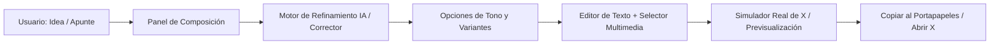

# 01. Arquitectura Técnica y Estrategia de Implementación 🛠️

Este documento describe la arquitectura técnica propuesta para el **Proyecto Comentarista**, analizando las opciones tecnológicas, el flujo de datos y los componentes del sistema.

---

## 1. Diagrama de Flujo de Trabajo



---

## 2. Decisión Arquitectónica: Opción B (Python Backend + Web UI + Conector Grafana)

> **Decisión de Diseño (Aprobada por el Usuario - 07/10/2026):**  
> Se selecciona la **Opción B (Arquitectura Python)** debido a la necesidad crítica de integrarse directamente con la instancia local de **Grafana** (`http://localhost:3000`), el motor de renderizado de imágenes de paneles de energía (`/render/d-solo/...`) y los scripts/datos del ecosistema de energía.

### 2.1. Comparativa y Justificación

| Criterio | Opción B: Python Backend + Web UI *(SELECCIONADA)* |
| :--- | :--- |
| **Integración con Grafana** | ⭐⭐⭐⭐⭐ Nativa y directa. Usa `requests` y la API de Grafana para extraer o renderizar paneles PNG en tiempo real con rangos temporales dinámicos (`now-24h`, fechas históricas). |
| **Acceso a BBDD y Scripts** | ⭐⭐⭐⭐⭐ Comunicación directa con la base de datos PostgreSQL / TimescaleDB de energía y reutilización de librerías Python existentes (`psycopg2`, `pandas`). |
| **Experiencia de Usuario (UI/UX)** | ⭐⭐⭐⭐⭐ Interfaz web servida en `localhost:8000` con HTML5 semántico, **Vanilla CSS** premium (Dark Mode idéntico a X) y Vanilla JS reactivo. |
| **Simulador de X** | Componente visual reactivo con contador circular de caracteres SVG, preview de medios y copia con 1 clic al portapapeles. |
| **Ejecución en Windows** | Lanzador `iniciar_comentarista.bat` de un clic que inicia el servidor Python y abre el navegador automáticamente. |

---

## 3. Componentes de la Arquitectura Seleccionada

### 3.1. Servidor Backend en Python
- **Framework**: Python HTTP / FastAPI / Starlette ligero con servidor ASGI (`uvicorn`, ya disponible en el sistema).
- **Módulos Core**:
  1. `core/grafana_client.py`: Conector autenticado con Grafana (`http://localhost:3000`):
     - Catálogo de dashboards disponibles (PVPC, Generación, Demanda, Balance).
     - Renderizado bajo demanda de paneles PNG mediante `/render/d-solo/...` especificando ancho, alto y ventana de tiempo (`from`/`to`).
  2. `core/ai_assistant.py`: Motor de refinamiento y corrección ortográfica de tweets (soporte para Google Gemini / OpenAI / prompts parametrizados).
  3. `core/media_manager.py`: Gestor de capturas, imágenes temporales y gráficos generados.
  4. `core/clipboard.py` y endpoints REST: API para suministrar datos limpios al frontend y sincronizar con portapapeles.

### 3.2. Frontend Web (Servido Localmente)
- **Estructura**:
  - `app/templates/index.html`: Estructura semántica de dos paneles (Compositor & Simulador X).
  - `app/static/css/style.css`: Vanilla CSS con diseño ultra premium, estética oscura de X, tipografía Inter y microinteracciones fluidas.
  - `app/static/js/app.js`: Lógica de cliente (actualización en vivo del Tweet, contador circular de caracteres, selección de paneles de Grafana, copia al portapapeles con feedback visual).

### 3.3. Integración con Grafana Local
- **URL Base**: `http://localhost:3000`
- **Render Engine**: Servicio integrado de renderizado PNG (`/render/d-solo/<slug>/<uid>?panelId=<id>&width=1200&height=630&from=<from>&to=<to>`).
- **Proporción de Imagen para X**: Render optimizado a 1200x675 px (proporción 16:9, el estándar óptimo de visualización en tarjetas de X).

---

## 4. Estructura de Módulos del Proyecto

```
2026_Proyecto_Comentarista/
├── docs/                        # Documentación estratégica y técnica
│   ├── 00_Strategy/             # Visión, arquitectura, roadmap y logs
│   ├── 01_Mockups/              # Wireframes y especificaciones visuales
│   └── 05_User_Stories/         # Historias de usuario y flujos
├── app/ o web/                  # Código fuente de la aplicación
│   ├── components/              # TweetCard, PromptInput, MediaPicker, CopyBar
│   ├── api/                     # Endpoints de generación y medios
│   └── styles/                  # Sistema de diseño con Vanilla CSS
├── data/                        # Historial local de borradores
├── iniciar_comentarista.bat      # Lanzador directo de escritorio para Windows
├── README.md                    # Manual y visión general del repositorio
└── .gitignore                   # Exclusiones de control de versiones
```
