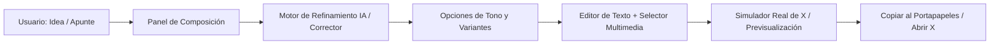

# 01. Arquitectura Técnica y Estrategia de Implementación 🛠️

Este documento describe la arquitectura técnica propuesta para el **Proyecto Comentarista**, analizando las opciones tecnológicas, el flujo de datos y los componentes del sistema.

---

## 1. Diagrama de Flujo de Trabajo



---

## 2. Comparativa de Alternativas Tecnológicas

Para ofrecer la mejor experiencia en el ordenador personal del usuario (Windows), se evalúan dos enfoques principales:

| Criterio | Opción A: Web App Local Moderna (Next.js / Vite + Vanilla CSS) *(Recomendada)* | Opción B: Aplicación Local Python + Web Server (FastAPI / Flask + Vanilla JS) |
| :--- | :--- | :--- |
| **Experiencia de Usuario (UI/UX)** | ⭐⭐⭐⭐⭐ Interfaz fluida, idéntica a X, diseño dark mode reactivo, animaciones suaves. | ⭐⭐⭐⭐ Buena interfaz web mediante HTML/CSS/JS servido localmente. |
| **Simulador de X (Tweet Preview)** | Componentes React reutilizables con renderizado en tiempo real y contador dinámico. | Renderizado DOM mediante Vanilla JS reactivo. |
| **Acceso a Archivos Locales** | Vía API routes locales (`/api/media`) para explorar carpetas del ordenador. | Acceso directo al sistema de archivos mediante `os` / `pathlib`. |
| **Integración con IA** | SDK de Google GenAI / Anthropic / OpenAI en backend Node.js. | SDK de Python (`google-genai`, `openai`, `anthropic`, etc.). |
| **Facilidad de Ejecución** | Script `.bat` (`npm run dev`) que abre automáticamente el navegador en `localhost:3000`. | Script `.bat` (`python main.py`) que abre el navegador en `localhost:8000`. |
| **Alineación con otros proyectos** | Idéntico a `2026_Proyecto_Certificado_Humano` (Next.js, Vanilla CSS). | Idéntico al backend de `2026_Proyecto_Energia_Graficos` (Python). |

---

## 3. Arquitectura Recomendada (Opción Híbrida / Web App Local)

Adoptamos una arquitectura orientada a la **máxima simplicidad de uso** para el usuario:

### 3.1. Frontend (Capa de Presentación)
- **Tecnología**: Next.js (App Router) o Vite + React con **Vanilla CSS** (siguiendo las directrices del workspace).
- **Diseño visual**:
  - Tema oscuro de alto contraste inspirado en la estética oficial de X (Black / Dark Slate / Accent Blue `#1d9bf0`).
  - Tipografía moderna (Inter / Twitter Chirp aesthetic).
  - Dos columnas de trabajo:
    - **Columna Izquierda (Control & IA)**: Entrada de idea, selector de tono, selector de fuente de datos/imágenes, variantes generadas.
    - **Columna Derecha (Preview & Acción)**: Tweet Card idéntica a X, contador de caracteres con semáforo (verde/ámbar/rojo), botones de acción rápida ("Copiar Texto", "Copiar Imagen", "Lanzar en X").

### 3.2. Backend & Servicios Locales
- **API Routes**:
  - `/api/generate`: Recibe la idea, el tono y las instrucciones del usuario; llama al modelo de IA para sugerir variantes pulidas y corregidas.
  - `/api/media`: Permite listar o seleccionar archivos multimedia de carpetas locales (ej. gráficos recientes generados en proyectos de energía).
  - `/api/history`: Guarda un registro local (SQLite o JSON) con el historial de publicaciones preparadas.

### 3.3. Integración con el Entorno Local
- Archivo ejecutable de un clic en Windows:
  - `iniciar_comentarista.bat`: Lanza el servidor local en segundo plano y abre la ventana en el navegador predeterminado de inmediato.

---

## 4. Estructura de Módulos del Proyecto

```
2026_Proyecto_Comentarista/
├── docs/                        # Documentación estratégica y técnica
│   ├── 00_Strategy/             # Visión, arquitectura, roadmap y logs
│   ├── 01_Mockups/              # Wireframes y especificaciones visuales
│   └── 05_User_Stories/         # Historias de usuario y flujos
├── app/ o web/                  # Código fuente de la aplicación
│   ├── components/              # TweetCard, PromptInput, MediaPicker, CopyBar
│   ├── api/                     # Endpoints de generación y medios
│   └── styles/                  # Sistema de diseño con Vanilla CSS
├── data/                        # Historial local de borradores
├── iniciar_comentarista.bat      # Lanzador directo de escritorio para Windows
├── README.md                    # Manual y visión general del repositorio
└── .gitignore                   # Exclusiones de control de versiones
```
