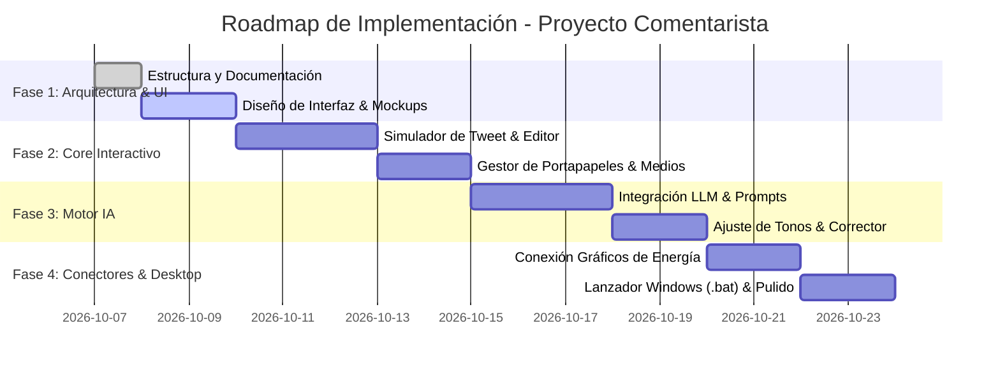

# 02. Roadmap y Fases de Desarrollo 🗺️🚀

Plan de ejecución paso a paso para la construcción del **Proyecto Comentarista**.

---

## 📌 Cronograma por Fases

---

## 📋 Detalle de Fases

### Fase 1: Estructuración & Diseño Visual (En curso)
- [x] Creación de la estructura del repositorio (`docs/`, `00_Strategy/`, etc.).
- [x] Definición de estrategia técnica y requisitos de usuario.
- [ ] Creación de wireframes y especificaciones del simulador de Tweet en `docs/01_Mockups/`.
- [ ] Definición del sistema de diseño (paleta de colores oscura tipo X, tipografía, variables CSS).

### Fase 2: Core Interactivo (Simulador & Editor Local)
- [ ] Creación de la interfaz principal:
  - Input para la idea original del usuario.
  - Editor interactivo de texto con contador dinámico de 280 caracteres.
  - Alerta visual cuando se excede el límite (indicador circular y desglose de caracteres).
  - Selector/arrastrador de imagen o vídeo local.
- [ ] Renderizado fiel del Tweet (Avatar, Nombre, `@handle`, insignias, imagen renderizada).
- [ ] Botones de acción rápida:
  - Copiar texto formateado al portapapeles.
  - Copiar imagen al portapapeles o abrir carpeta de origen.
  - Botón de enlace directo a X (`intent/tweet`).

### Fase 3: Motor Asistente de IA (Pulido & Ortografía)
- [ ] Integración de API de IA (Gemini / Anthropic / OpenAI).
- [ ] Modos de optimización:
  - **Corrector & Pulido**: Conserva las palabras del usuario, corrige ortografía y mejora la fluidez.
  - **Tono Divulgativo**: Explica conceptos técnicos de forma accesible para el gran público.
  - **Tono Analítico**: Preciso, con datos cuantitativos y enfoque riguroso de mercado.
  - **Tono Noticioso / Alerta**: Conciso, con gancho inicial y formato periodístico.
- [ ] Generación de 3 variantes con un solo clic para comparar y elegir.

### Fase 4: Conectores Locales y Experiencia Desktop
- [ ] Integración con `2026_Proyecto_Energia_Graficos`:
  - Explorador para seleccionar los gráficos más recientes de ESIOS, precios o demanda generados por los scripts de energía.
- [ ] Creación del script `iniciar_comentarista.bat` para iniciar la aplicación con doble clic en Windows.
- [ ] Historial de tweets preparados y guardado de borradores frecuentes.
